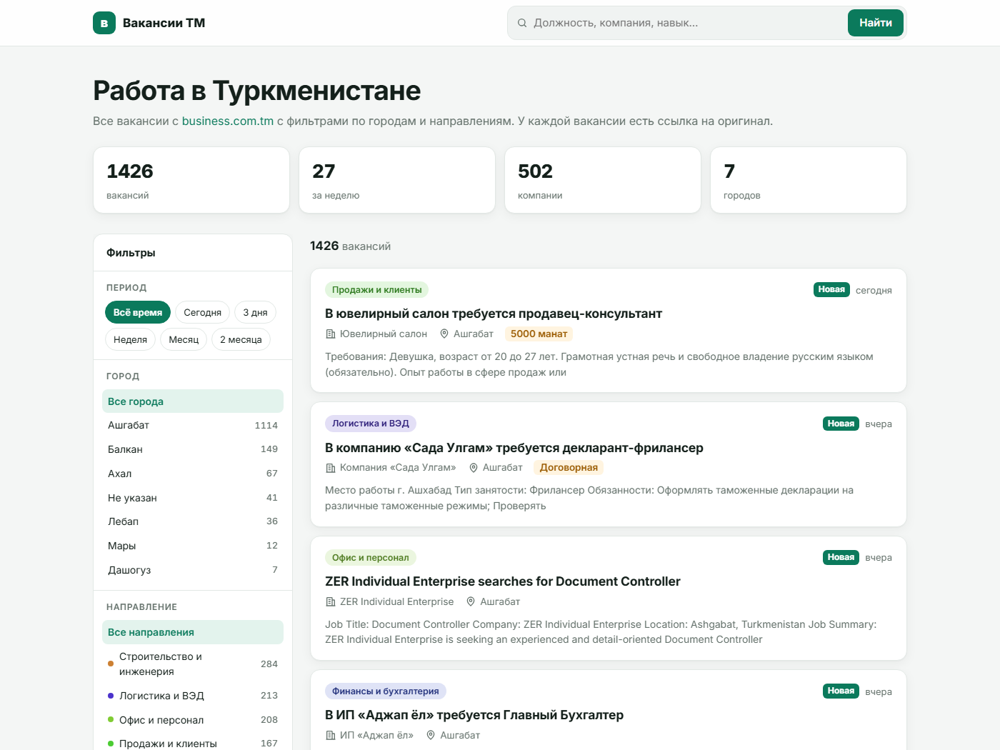
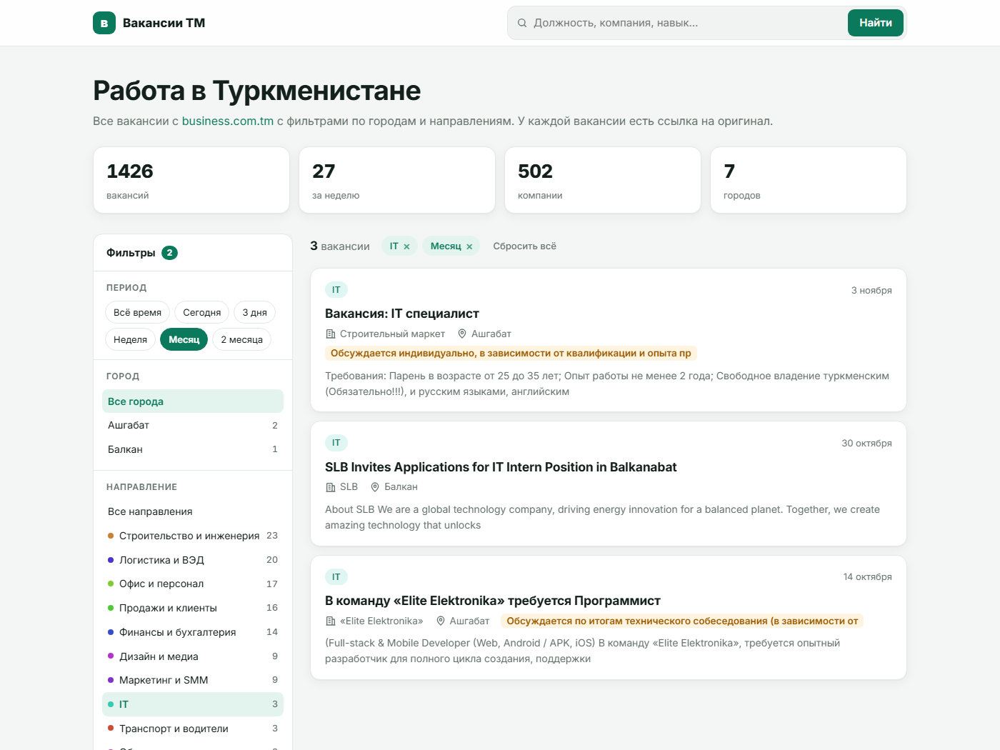
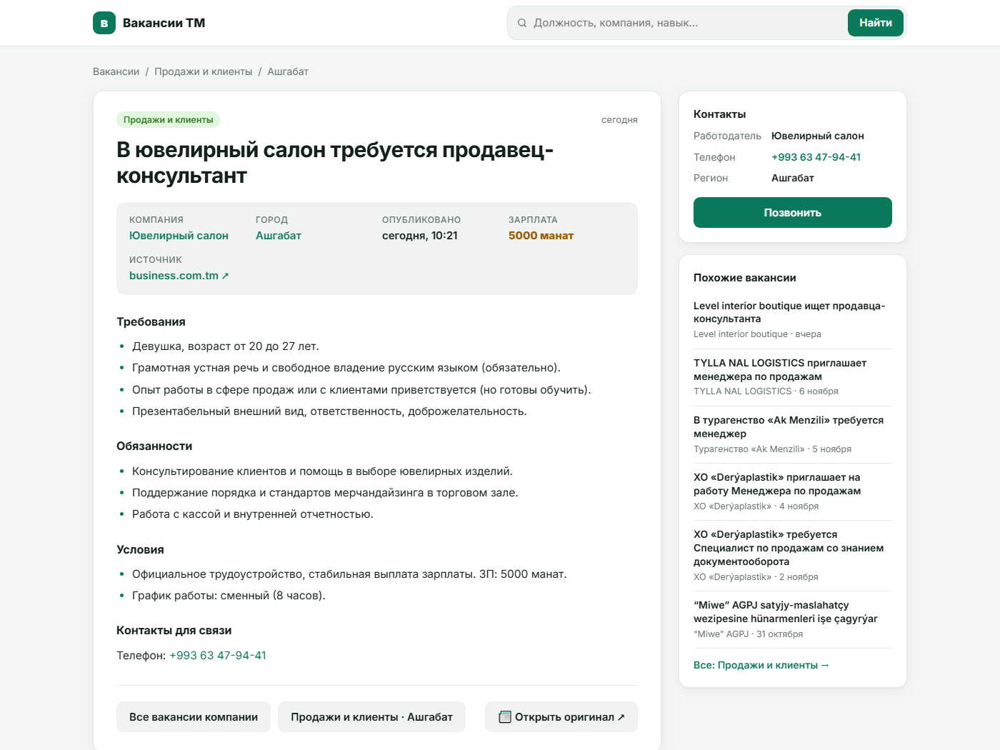
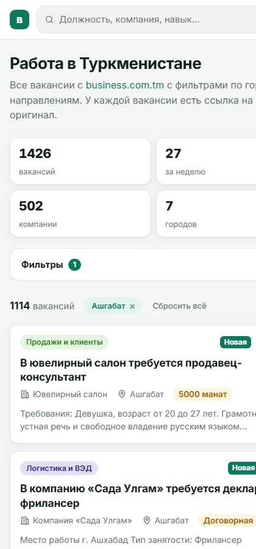
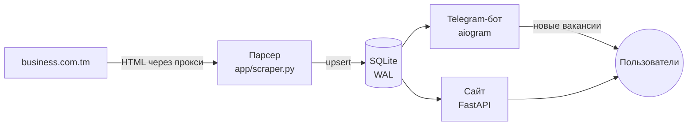

# Вакансии ТМ: агрегатор вакансий Туркменистана

Зеркало раздела вакансий [business.com.tm](https://business.com.tm/ru/work/rabota/vakansii)
с тем, чего нет в оригинале: фильтры по городам и направлениям, поиск, пометки устаревших
объявлений и Telegram-бот с подписками на новые вакансии.



## Зачем

На исходном сайте вакансии идут сплошной лентой из ~140 страниц: нет фильтра по городу и
сфере, а объявления не снимаются годами. Проект собирает все вакансии, раскладывает их
по 18 направлениям, достаёт зарплату и контакты и отдаёт это в двух видах:

- **сайт**: удобный поиск с фильтрами и полными текстами, без перехода на источник;
- **Telegram-бот**: подписка «город + направление + ключевые слова» с мгновенными
  уведомлениями или ежедневной подборкой.

## Возможности

**Сайт** (FastAPI + Jinja2, рендеринг на сервере)
- фильтры: город, направление, период, язык объявления, компания + полнотекстовый поиск;
  счётчики у каждого варианта, состояние фильтров в URL;
- страница вакансии: полный текст, контакты (телефон, почта кликабельны), зарплата, похожие вакансии;
- метки «Новая» и предупреждение для объявлений старше месяца;
- SEO: `sitemap.xml`, `robots.txt`, разметка `JobPosting`, канонические ссылки; JSON API `/api/vacancies`;
- адаптивная вёрстка, тёмная тема.

**Telegram-бот** (aiogram 3)
- фильтры кнопками: города, направления, ключевые слова; поиск просто текстом;
- карточка вакансии с полным текстом в сворачиваемой цитате, контактами, избранным;
- уведомления: «сразу», «раз в день» или выключены;
- у каждой вакансии ссылки на сайт-зеркало и на оригинал на business.com.tm;
- админка внутри бота: статистика, пользователи и бан, рассылка с превью, пауза уведомлений.

**Парсер**
- инкрементальный: каждые 30 минут проверяет первую страницу и докачивает только новое;
- полные тексты в 4 потока, ретраи с экспоненциальной паузой, остановка после 5 ошибок подряд;
- работа через прокси (источник отвечает только домашним IP из РФ/ТМ).

| Фильтры | Вакансия | Телефон |
|---|---|---|
|  |  |  |

## Архитектура



Все три процесса работают с одной SQLite-базой. Режим WAL позволяет парсеру писать в неё,
пока сайт и бот читают.

## Интересные решения

- **Классификация без ML.** Направление определяется словарём основ слов на русском,
  английском и туркменском (`app/classify.py`). Сначала проверяется название, потом текст,
  при равенстве побеждает более узкое направление. В «Другое» попадает меньше 1% вакансий.
- **Зарплата из свободного текста.** Регулярное выражение ищет «ЗП / зарплата / оклад / salary /
  aýlyk», за которыми идёт число или «договорная». Фраза «выплата зарплаты вовремя»
  зарплатой не считается.
- **Поиск коротких слов.** Запрос «IT» через `LIKE` находил 522 вакансии: подстрока «it» есть
  в «Elite» и «with». Слова до 3 букв ищутся целым словом в названии через пользовательскую
  функцию `REGEXP` в SQLite, и запрос даёт 61 точное совпадение.
- **Извлечение текста вакансии.** Сначала по известному селектору. Если он не сработал,
  выбирается наименьший блок страницы, который содержит анонс из списка и не ссылается
  на саму вакансию, чтобы не захватить виджет «Читайте также».
- **Уведомления без пропусков.** Каждому пользователю хранится «водяной знак»: id
  последней отправленной вакансии. Граница сдвигается, только когда у всех более ранних
  вакансий загружен полный текст, поэтому ни одна вакансия не теряется и не приходит дважды.
- **Устаревшие объявления.** Источник хранит вакансии год. Старше 30 дней получают
  предупреждение, а в `JobPosting` указан `validThrough`, чтобы поисковики их не показывали.

## Быстрый старт (локально)

```bash
python -m venv .venv
.venv/bin/pip install -r requirements-dev.txt        # Windows: .venv\Scripts\pip
.venv/bin/python -m app.scraper --pages 3 --details 30   # нужен IP из РФ/ТМ или SCRAPER_PROXY
.venv/bin/uvicorn app.main:app --reload               # http://127.0.0.1:8000
```

Бот:
```bash
export BOT_TOKEN=... ADMIN_IDS=<ваш telegram id>
.venv/bin/python -m bot.main
```

Тесты (21 тест: разбор HTML, классификация, зарплаты, поиск, страницы сайта):
```bash
.venv/bin/python -m pytest -q
```

Деплой на сервер (screen, nginx, прокси для Telegram) описан в [docs/DEPLOY.md](docs/DEPLOY.md).

## Структура

```
app/
  scraper.py     парсер: список → страницы вакансий → SQLite; CLI-флаги --full/--refetch/--reclassify
  classify.py    направления, язык, зарплата
  db.py          схема, миграции, запросы с фильтрами
  main.py        сайт, API, sitemap
  templates/, static/
bot/
  user.py        меню, фильтры, просмотр, поиск, избранное
  admin.py       /admin: статистика, пользователи, рассылка
  notifier.py    мгновенные уведомления и дайджест
  storage.py     таблицы бота (пользователи, избранное)
  ui.py          тексты и клавиатуры
tests/           pytest + синтетические HTML-образцы
deploy/          nginx.conf
*.sh             setup, запуск в screen, проверка окружения
```

## Конфигурация

Все настройки задаются переменными окружения. Шаблон с комментариями: [settings.example.sh](settings.example.sh).

| переменная | назначение |
|---|---|
| `BOT_TOKEN`, `ADMIN_IDS` | токен бота и id админов |
| `TELEGRAM_PROXY` / `TELEGRAM_API_URL` | доступ к Telegram из РФ |
| `SCRAPER_PROXY` | прокси для источника |
| `SCRAPE_EVERY`, `SCRAPE_WORKERS`, `SCRAPE_DELAY` | частота и нагрузка парсера |
| `SITE_URL`, `SITE_PORT` | адрес сайта (для ссылок из бота и sitemap) |

## Стек

Python 3.10+, FastAPI, Jinja2, SQLite, requests + BeautifulSoup, aiogram 3, pytest, nginx.

## Дисклеймер

Учебный проект. Все вакансии и контакты принадлежат business.com.tm и работодателям;
на каждой странице стоит ссылка на источник. Парсер делает паузы между запросами и
скачивает только новые страницы. В репозитории нет собранных данных.

## Лицензия

[MIT](LICENSE)
